<div align="center">

ĐẠI HỌC QUỐC GIA HÀ NỘI · **TRƯỜNG ĐẠI HỌC CÔNG NGHỆ** · VIỆN TRÍ TUỆ NHÂN TẠO

# Báo cáo bài tập lớn – Level 2: Tic-tac-toe

**Lập trình hướng đối tượng & Giao diện đồ hoạ SDL2**<br>
Học phần: Phương pháp luận lập trình (2526II.UET.AI2013)

| Sinh viên | MSSV | Lớp | Ngành |
|:---:|:---:|:---:|:---:|
| Hoàng Trung Hiếu | 25022849 | K70A-AI2 | Trí tuệ nhân tạo |

Hà Nội, tháng 10 năm 2026 · [← Về trang chính](../README.md)

</div>

> [!NOTE]
> Đây là báo cáo đã nộp cho học phần, chuyển sang Markdown để đọc trực tiếp trên GitHub. Bản trên repo có thêm vài chỉnh sửa nhỏ để chạy được trên trình duyệt (xem [README](../README.md)).

## Mục lục

1. [Tổng quan](#1-tổng-quan-overview)
2. [Chi tiết cài đặt](#2-chi-tiết-cài-đặt-implementation-details)
   - [2.1 Luồng thực thi của Engine](#21-tư-duy-thiết-kế-luồng-thực-thi-của-engine)
   - [2.2 Bot mức HARD: Minimax + Alpha-Beta + Heuristic](#22-bot-mức-hard-minimax--alpha-beta--heuristic)
   - [2.3 Giao diện đồ hoạ](#23-giao-diện-đồ-hoạ)
   - [2.4 Trả lời câu hỏi (OOP, SOLID, mẫu thiết kế)](#24-trả-lời-câu-hỏi)
3. [Kết quả thực nghiệm](#3-kết-quả-thực-nghiệm-experiment-results)
4. [Nhận xét và tổng kết](#4-nhận-xét-và-tổng-kết-bài-làm)
5. [Ghi chú sử dụng AI](#5-ghi-chú-sử-dụng-ai-ai-disclosure)
6. [Nguồn tham khảo](#6-nguồn-tham-khảo-references)

---

## 1. Tổng quan (Overview)

### 1.1 Thông tin cá nhân

- **Họ và tên:** Hoàng Trung Hiếu
- **MSSV:** 25022849 · **Lớp:** K70A-AI2
- **Sản phẩm:** trò chơi Tic-tac-toe/Caro trên bàn $N\times N$ ($3 \le N \le 12$), điều kiện thắng `goal` quân liên tiếp, 3 chế độ PvP / PvE / EvE, 3 mức bot (EASY, MEDIUM, HARD), chạy được trên cả **Terminal** và **GUI (SDL2)**.

### 1.2 Tổng quan luồng thực thi

Chương trình giữ **luồng tuần tự** (*sequential flow*) của starter code, được điều phối bởi lớp `Engine`:

```
init()  →  startGame()  →  playGame()  →  endGame()  →  close()
```

Điểm thay đổi so với luồng ban đầu là `main.cpp` bọc ba bước giữa trong một **vòng lặp chơi lại**: `endGame()` trả về một mã hành động (`int`) do người chơi chọn sau khi xem kết quả (SPACE = chơi lại), nhờ đó không phải khởi động lại chương trình sau mỗi ván. Engine chỉ làm việc với hai interface `I_Renderer`, `I_Interaction` nên cùng một luồng chạy cho cả Terminal và SDL.

<p align="center">
  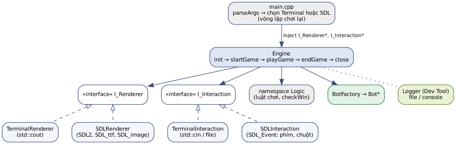<br>
  <sub><b>Hình 1.</b> Kiến trúc chương trình: <code>main</code> tiêm (inject) cài đặt cụ thể của giao diện vào <code>Engine</code>.</sub>
</p>

### 1.3 Giao diện đồ hoạ

- **Thư viện:** SDL2, SDL2_ttf (chữ), SDL2_image (ảnh PNG).
- **Hình thức hiển thị:** ảnh nền và *sprite* ảnh (logo HUST cho quân X, logo UET cho quân O), *vẽ hình học* (lưới bàn cờ, khung menu bán trong suốt, ô highlight nước vừa đi, đường đỏ đánh dấu đường thắng), *chữ* bằng font Playfair Display Bold 26pt.
- **Kiểu tương tác:** **bàn phím** (phím số hàng ngang và numpad, Backspace, Enter để xác nhận menu; SPACE/ESC sau khi kết thúc ván) và **chuột** (click trái vào ô để đánh). Chương trình chưa hỗ trợ tay cầm (controller).

### 1.4 Nội dung cập nhật trong phiên bản này

Phiên bản này **viết lại hoàn toàn bot mức HARD** (`BotLevel3`, tệp `src/game/bot/bot_lv3.*`) theo hướng **Minimax + cắt tỉa Alpha-Beta + hàm đánh giá Heuristic**. Các mô-đun còn lại (Engine, Logic, Terminal, SDL, BotLevel1/2, Factory, Utils) **giữ nguyên**. Bot cũ dài 995 dòng, dựa trên dò mẫu thủ công cho từng hướng; bot mới gồm các hàm nhỏ, mỗi hàm một nhiệm vụ, có chú thích tiếng Việt và được kiểm thử tự động (mục [2.2](#22-bot-mức-hard-minimax--alpha-beta--heuristic), [3.4](#34-đánh-giá-bot-hard-mới)).

---

## 2. Chi tiết cài đặt (Implementation Details)

### 2.1 Tư duy thiết kế luồng thực thi của Engine

**Cách xây dựng.** `Engine` nhận ba phụ thuộc qua constructor: `RunConfig*`, `I_Renderer*`, `I_Interaction*`. Mỗi bước trong luồng chỉ gọi các phương thức ảo của interface:

- `startGame()`: hiển thị tiêu đề rồi lần lượt hỏi `size`, `goal`, chế độ chơi, mức bot theo mẫu `do { showSelectMenu(); isSelected = select...(); } while(!isSelected);` — giống hệt nhau cho Terminal và SDL.
- `playGame()`: tạo bot qua `BotFactory`, sau đó lặp theo lượt: *lấy nước đi* (bot: `getMove()`; người: `getPlayerMove()`) → `Logic::makeMove` → `Logic::checkWin / checkDraw` → đổi lượt.
- `endGame()`: vẽ bàn cờ cuối, lấy `WinLine` để tô đường thắng, gọi `getPostGameAction()` và trả mã hành động cho `main`.

**Thay đổi so với luồng ban đầu.**

1. `endGame()` đổi kiểu trả về từ `void` sang `int`; bổ sung phương thức thuần ảo `getPostGameAction()` vào `I_Interaction` (SDL: SPACE/ESC; Terminal: mặc định chơi lại) và vòng lặp chơi lại trong `main.cpp`.
2. Phía SDL, `pause()` và các hàm `select...()` dùng `SDL_WaitEvent` để "giả lập" việc chờ nhập như `std::cin`; `showValidSelect()` đẩy một sự kiện phím giả (`SDLK_F15`) để giải phóng lời gọi `pause()` tiếp theo; `SDL_FlushEvents` được gọi trước mỗi lần nhận input để xoá sự kiện còn sót.
3. `BotLevel3` được thay bằng thuật toán tìm kiếm trên cây trò chơi (chi tiết ở mục [2.2](#22-bot-mức-hard-minimax--alpha-beta--heuristic)); Engine không phải sửa gì vì vẫn gọi qua `Bot::getMove()`.

**Lý do lựa chọn.** Giữ luồng tuần tự giúp Terminal (vốn chặn ở `std::cin`) và SDL dùng *chung một Engine* mà không cần hai phiên bản game loop. Mọi khác biệt về cách hiển thị/nhận input bị đẩy xuống lớp cài đặt cụ thể.

**Ưu điểm.** Đơn giản, dễ theo dõi bằng log; Engine độc lập với giao diện; thêm giao diện mới chỉ cần cài đặt hai interface.

**Nhược điểm.** SDL vốn hướng sự kiện (*event-driven*) nên khi bị "ép" vào luồng chặn (*blocking*): cửa sổ chỉ vẽ lại khi có sự kiện, không có FPS cố định hay animation; trong lúc Engine `sleep` 1.5 s sau nước đi của bot, cửa sổ không xử lý sự kiện. Hướng cải tiến là chuyển sang *state-based loop* (`listenEvent → handleEvent → render`) với các trạng thái MENU / PLAYING / RESULT.

### 2.2 Bot mức HARD: Minimax + Alpha-Beta + Heuristic

#### Vấn đề của phiên bản cũ

Bot HARD cũ kế thừa `BotLevel2` nhưng toàn bộ logic nằm trong một hàm `hard_level()` 995 dòng: lặp lại gần như y hệt một khối mã cho 8 hướng (chéo chính/phụ, ngang, dọc, tiến/lùi) để tìm chuỗi `goal-1`, `goal-2`, … quân rồi đánh vào đầu chuỗi; nếu không thấy thì đánh ngẫu nhiên. Cách làm này chỉ "nhìn" một nước, khó đọc, khó sửa và không tận dụng được tư duy tìm kiếm trên không gian trạng thái.

#### Ý tưởng thuật toán

Bot mới xem trò chơi như một **cây trò chơi** (*game tree*): gốc là bàn cờ hiện tại, mỗi cạnh là một nước đi, các tầng luân phiên giữa bot (MAX) và đối thủ (MIN).

- **Minimax:** giá trị một nút MAX là giá trị lớn nhất của các con, nút MIN là giá trị nhỏ nhất — tức giả sử đối thủ luôn đánh nước tốt nhất cho họ.
- **Cắt tỉa Alpha-Beta:** duy trì $\alpha$ (điểm tốt nhất MAX chắc chắn đạt được) và $\beta$ (điểm tốt nhất MIN chắc chắn đạt được). Khi $\alpha \ge \beta$, nhánh hiện tại không thể ảnh hưởng tới quyết định ở tầng trên nên bị bỏ qua. Kết quả giống hệt Minimax nhưng duyệt ít nút hơn nhiều.
- **Giới hạn độ sâu + Heuristic:** bàn $12\times12$ có quá nhiều trạng thái để tìm đến cuối ván, nên khi hết độ sâu cho phép, bàn cờ được chấm điểm bằng hàm đánh giá.

Trước khi tìm kiếm, bot kiểm tra hai trường hợp rõ ràng: (1) có nước **thắng ngay** thì đánh luôn; (2) đối thủ có nước thắng ngay thì **chặn**.

<table>
  <tr>
    <td align="center" width="50%">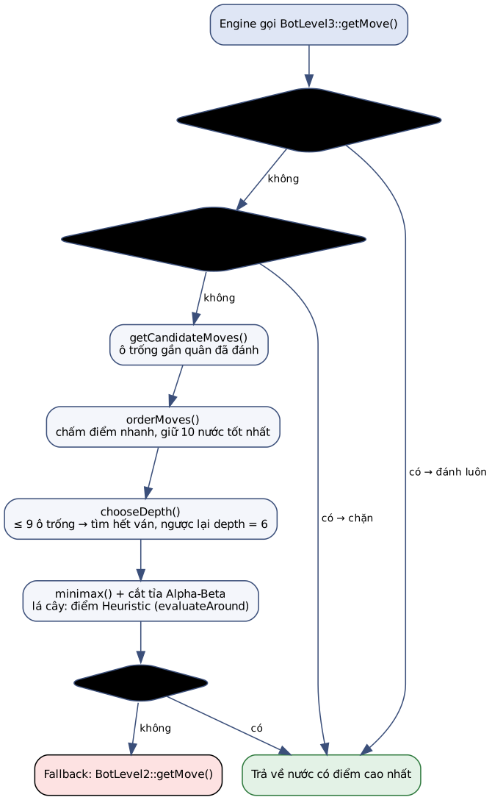</td>
    <td align="center" width="50%">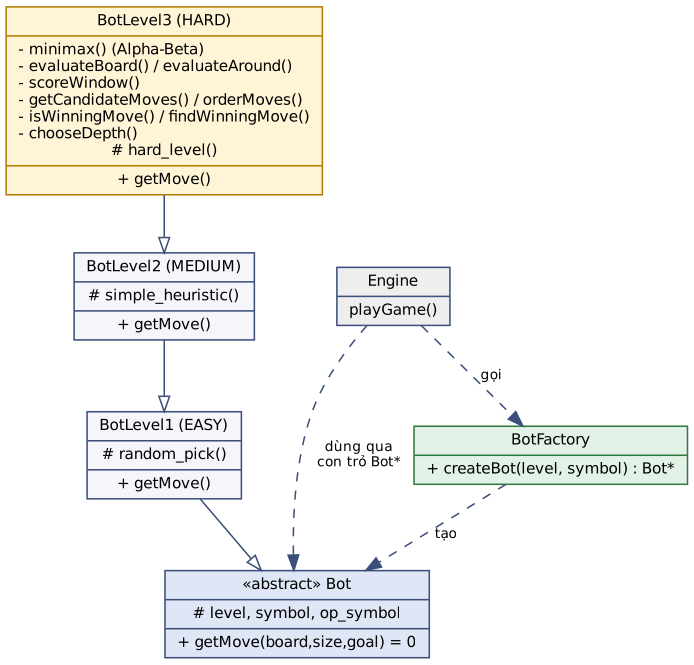</td>
  </tr>
  <tr>
    <td align="center"><sub><b>Hình 2.</b> Luồng quyết định của <code>BotLevel3::getMove()</code>.</sub></td>
    <td align="center"><sub><b>Hình 3.</b> Vị trí của <code>BotLevel3</code> trong cây kế thừa Bot và quan hệ với <code>BotFactory</code>, <code>Engine</code>.</sub></td>
  </tr>
</table>

#### Hàm đánh giá Heuristic: đếm "cửa sổ"

Một **cửa sổ** (*window*) là một đoạn `goal` ô liên tiếp theo một trong 4 hướng (ngang, dọc, hai đường chéo). Chỉ những cửa sổ *chưa có quân đối phương* mới còn khả năng trở thành đường thắng. Điểm của mỗi cửa sổ:

```math
\text{score}(w) =
\begin{cases}
0 & \text{nếu } w \text{ có quân của cả hai bên},\\
+10^{\,b} & \text{nếu } w \text{ chỉ có } b>0 \text{ quân của bot},\\
-10^{\,o} & \text{nếu } w \text{ chỉ có } o>0 \text{ quân đối thủ},\\
0 & \text{nếu } w \text{ trống}.
\end{cases}
\qquad
\text{Eval(board)} = \sum_{w} \text{score}(w)
```

Cơ số 10 khiến một cửa sổ có $k$ quân "nặng" hơn mười cửa sổ có $k-1$ quân, nên bot ưu tiên kéo dài chuỗi dài nhất. Một nước đi tốt vừa *tăng* điểm cửa sổ của mình (tấn công) vừa *xoá* điểm cửa sổ của đối thủ (phòng thủ) vì đặt quân vào cửa sổ của họ làm cửa sổ đó về 0.

<details>
<summary><b>Listing 1.</b> <code>scoreWindow()</code> – chấm điểm một cửa sổ</summary>

```cpp
BotLevel3::Score BotLevel3::scoreWindow(const char board[][BOARD_N_MAX], const int goal,
                                        const int row, const int col, const int dRow, const int dCol) const {
    int botCount = 0;
    int opCount = 0;
    for (int i = 0; i < goal; i++) {
        const char cell = board[row + i * dRow][col + i * dCol];
        if (cell == symbol) botCount++;
        else if (cell == op_symbol) opCount++;
    }

    if (botCount > 0 && opCount > 0) return 0;
    if (botCount > 0) return powerOf10(botCount);
    if (opCount > 0) return -powerOf10(opCount);
    return 0;
}
```

</details>

**Cập nhật điểm tăng dần.** Tính lại `Eval` cho cả bàn ở mỗi nút tốn $O(4N^2\cdot goal)$. Vì một nước đi chỉ làm thay đổi các cửa sổ *đi qua ô vừa đánh*, bot dùng `evaluateAround(row, col)` (chỉ quét tối đa $4\cdot goal$ cửa sổ, chi phí $O(4\cdot goal^2)$) và cập nhật:

```math
\text{Eval}_{\text{mới}} = \text{Eval}_{\text{cũ}} - \text{around}_{\text{trước khi đặt}}(r,c) + \text{around}_{\text{sau khi đặt}}(r,c)
```

Mức chênh lệch này (`gain`) được tính một lần trong `orderMoves()` và truyền xuống `minimax()` qua tham số `currentScore`, nên ở lá cây chỉ cần trả về `currentScore` — chi phí $O(1)$.

#### Sinh nước đi, sắp xếp và chọn độ sâu

- `getCandidateMoves()`: bàn ≤ 5×5 xét mọi ô trống; bàn lớn chỉ xét ô trống *kề* (khoảng cách 1) một quân đã đánh — nước ở xa hầu như vô nghĩa. Bàn trống: đánh ô giữa.
- `orderMoves()`: chấm `gain` cho từng nước, sắp xếp giảm dần (với đối thủ là tăng dần) và **chỉ giữ 10 nước tốt nhất** mỗi tầng (`MAX_BRANCH`). Nước tốt được xét trước làm Alpha-Beta cắt tỉa sớm hơn.
- `chooseDepth()`: còn ≤ 9 ô trống (toàn bộ bàn 3×3 hoặc cuối ván) thì tìm **đến hết ván** ⇒ đánh hoàn hảo; ngược lại dùng độ sâu 6 (3 lượt mỗi bên).
- Thắng càng sớm điểm càng cao: nút thắng trả về `WIN_SCORE + depth` (`depth` là số tầng còn lại), nên bot chọn đường thắng ngắn nhất và kéo dài ván khi buộc phải thua.

<details>
<summary><b>Listing 2.</b> <code>minimax()</code> có cắt tỉa Alpha-Beta</summary>

```cpp
BotLevel3::Score BotLevel3::minimax(char board[][BOARD_N_MAX], const int size, const int goal,
                                    int depth, Score alpha, Score beta, bool isBotTurn, Score currentScore) {
    visitedNodes++;

    // 1. Hết độ sâu → trả về điểm heuristic
    if (depth == 0) return currentScore;

    // 2. Không còn nước đi → hòa
    std::vector<pII> candidates = getCandidateMoves(board, size);
    if (candidates.empty()) return 0;

    const char who = isBotTurn ? symbol : op_symbol;
    std::vector<ScoredMove> moves = orderMoves(board, size, goal, candidates, who, MAX_BRANCH);

    Score best = isBotTurn ? -INF : INF;

    for (const ScoredMove& move : moves) {
        const auto [row, col] = move.cell;
        makeMove(board, row, col, who);  // đặt thử

        Score value;
        if (isWinningMove(board, size, goal, row, col, who)) {
            // Thắng càng sớm (depth còn lại càng lớn) thì điểm càng cao
            value = isBotTurn ? (WIN_SCORE + depth) : -(WIN_SCORE + depth);
        } else {
            value = minimax(board, size, goal, depth - 1, alpha, beta, !isBotTurn, currentScore + move.gain);
        }

        board[row][col] = EMPTY_CELL;  // gỡ quân

        if (isBotTurn) {
            best = std::max(best, value);  // MAX: bot chọn điểm lớn nhất
            alpha = std::max(alpha, best);
        } else {
            best = std::min(best, value);  // MIN: đối thủ chọn điểm nhỏ nhất
            beta = std::min(beta, best);
        }

        if (alpha >= beta) break;  // cắt tỉa Alpha-Beta
    }
    return best;
}
```

</details>

#### Kiểm tra thắng khớp với luật của game

Luật thắng của `Logic::checkWin` (mặc định `EndRule::OPEN_TWO`) là: có `goal` quân liên tiếp và *hai ô kẹp hai đầu không phải quân đối phương* (ô trống hoặc ngoài bàn đều được) — tức chuỗi bị chặn hai đầu không tính thắng. Nếu bot dùng luật khác Engine, nó sẽ "tưởng" mình thắng trong khi Engine không công nhận. Vì vậy `isWinningMove()` cài đặt đúng luật này nhưng chỉ xét 4 đường đi qua ô vừa đánh (nhanh hơn quét cả bàn): mở rộng về hai phía để tìm dãy quân liên tiếp, rồi thử mọi đoạn dài `goal` trong dãy đó.

Tính tương đương được kiểm tra bằng chương trình thử nghiệm riêng: sinh ngẫu nhiên **168 060** thế cờ (kích thước 3–12, `goal` 3–6), so sánh kết quả của `isWinningMove()` với `Logic::checkWin()` — **khớp 100%** (0 sai lệch).

#### Thể hiện OOP trong bot mới

- **Kế thừa:** `BotLevel3 : public BotLevel2` và **override** `getMove()`; khi kết quả không hợp lệ thì gọi lại `BotLevel2::getMove()` (fallback) — tái sử dụng hành vi lớp cha.
- **Đóng gói:** toàn bộ hàm phụ trợ (`minimax`, `evaluateBoard`, `orderMoves`, …), kiểu `ScoredMove` và bộ đếm `visitedNodes` là `private`; hằng số (`WIN_SCORE`, `MAX_BRANCH`, …) nằm trong *anonymous namespace* của tệp `.cpp`. Engine chỉ thấy `getMove()`.
- **Đa hình:** Engine giữ `std::unique_ptr<Bot>` và gọi `bots[player]->getMove(...)` mà không biết đó là bot mức nào.

### 2.3 Giao diện đồ hoạ

#### Hiển thị (Rendering)

- **Khởi tạo:** `SDLRenderer::init()` gọi `SDL_Init`, `TTF_Init`, `IMG_Init(IMG_INIT_PNG)`, tạo cửa sổ 1000×700 và renderer tăng tốc phần cứng, bật `SDL_BLENDMODE_BLEND` để vẽ hình bán trong suốt; nạp 3 ảnh PNG thành `SDL_Texture` một lần duy nhất và mở font 26pt.
- **Menu:** vẽ ảnh nền, phủ hộp đen alpha 210 có viền vàng, chữ được render bằng `TTF_RenderUTF8_Blended` (khử răng cưa) và căn giữa theo chiều ngang.
- **Bàn cờ:** vùng 480×480 px đặt giữa cửa sổ, `CELL = 480 / size`; lưới vẽ bằng `SDL_RenderDrawLine` (3 nét sát nhau cho dày), mỗi quân là một texture logo được `SDL_RenderCopy` vào ô với lề 10%. Nước vừa đi được viền vàng 4 px; khi kết thúc, đường thắng là 7 đoạn thẳng đỏ song song nối tâm ô đầu và ô cuối của `WinLine`.
- **Lý do lựa chọn:** dùng logo trường làm quân cờ tạo chủ đề "UET vs HUST" trực quan; texture được nạp sẵn nên mỗi lần vẽ chỉ là thao tác sao chép trên GPU.
- **Hiệu năng:** chương trình vẽ *theo yêu cầu* (mỗi lượt vẽ lại một lần) chứ không có vòng lặp khung hình, nên không có chỉ số FPS. Phần tốn thời gian nhất trong mỗi lượt là bot suy nghĩ; thời gian này được đo bằng `measureExecutionTime` và ghi vào log ([Bảng 3](#34-đánh-giá-bot-hard-mới)): trung bình ≈ 0.05 s, tối đa ≈ 0.18 s/nước trên bàn 12×12 — nhỏ hơn nhiều so với độ trễ 1.5 s cố ý chèn vào để người chơi kịp quan sát.

#### Tương tác (Interaction)

- **Bàn phím:** các hàm `select...()` đọc `SDL_KEYDOWN` (bỏ qua phím lặp `repeat != 0`); mỗi phím số được cộng dồn `inputVal = inputVal*10 + digit`, Backspace xoá chữ số cuối, Enter xác nhận rồi kiểm tra miền giá trị (ví dụ $3 \le size \le 12$, $3 \le goal \le size$).
- **Chuột:** `getPlayerMove()` chờ `SDL_MOUSEBUTTONDOWN` chuột trái, đổi toạ độ pixel sang ô: `col = (x - START_X) / CELL`, `row = (y - START_Y) / CELL`; click ngoài bàn bị bỏ qua, click vào ô đã có quân bị Engine từ chối qua `Logic::isValidMove` và `showInvalidMove()` hiện dải cảnh báo đỏ.
- **Sau ván:** `getPostGameAction()`: SPACE chơi lại, ESC về menu; nút đóng cửa sổ (`SDL_QUIT`) ném `QuitException` ở mọi thời điểm.
- **Khó khăn lớn nhất:** đồng bộ luồng chặn của Engine với hàng đợi sự kiện của SDL. Phím Enter của menu trước còn sót trong hàng đợi khiến menu sau bị xác nhận ngay, hoặc một click bị tính hai lần. Giải pháp: gọi `SDL_FlushEvents` trước mỗi lần chờ input và đẩy một sự kiện phím giả `SDLK_F15` (phím hiếm, không trùng phím chơi) để kết thúc `pause()` một cách có kiểm soát.

### 2.4 Trả lời câu hỏi

#### Câu 1 – Lập trình hướng đối tượng

Chương trình thể hiện đủ 4 nguyên lý:

| Nguyên lý | Minh chứng trong mã nguồn |
|---|---|
| **Đóng gói** | `Engine` giữ `config`, `iRenderer`, `iInteraction`, `gameSetup` ở `private`; `Bot` để `level`, `symbol`, `op_symbol` là `protected const`; `BotLevel3` ẩn toàn bộ hàm tìm kiếm, `ScoredMove`, hằng số trong anonymous namespace; `SDLRenderer` ẩn `SDL_Window*`, các texture, font. |
| **Kế thừa** | `Bot` → `BotLevel1` → `BotLevel2` → `BotLevel3`; `I_Renderer` → `TerminalRenderer`, `SDLRenderer`; `I_Interaction` → `TerminalInteraction`, `SDLInteraction`; `QuitException : std::exception`. |
| **Trừu tượng** | `I_Renderer`, `I_Interaction`, `Bot` là lớp trừu tượng (hàm thuần ảo `= 0`); Engine chỉ biết "có một thứ vẽ được, một thứ nhận input được, một thứ chọn nước đi được". |
| **Đa hình** | `iRenderer->displayBoard(...)` chạy `std::cout` hoặc SDL tuỳ đối tượng thực; `bots[player]->getMove(...)` gọi đúng thuật toán của từng mức; destructor ảo đảm bảo `delete` qua con trỏ lớp cha giải phóng đúng. |

Phần bổ sung so với mã nguồn cung cấp: `BotLevel3` mới (override + gọi lại lớp cha khi fallback), phương thức ảo mới `getPostGameAction()` được cả hai giao diện cài đặt theo cách riêng.

#### Câu 2 – Thiết kế cân bằng hai giao diện

Có. Thứ cốt lõi giúp thiết kế hài hoà là **Engine chỉ phụ thuộc vào interface** và cờ `config->interactive`; toàn bộ khác biệt (in chữ hay vẽ texture, đọc `cin` hay chờ `SDL_Event`) nằm trong lớp cài đặt. Nhờ đó `main.cpp` chỉ cần một câu `if (config.gui_flag)` để chọn bộ đôi Renderer/Interaction. Khó khăn là hai giao diện có bản chất khác nhau (chặn vs hướng sự kiện): phía SDL phải "mô phỏng" hành vi chặn bằng `SDL_WaitEvent` và sự kiện giả, còn một số hàm chỉ có ý nghĩa với một phía (`printResult` cho judge mode, `getPostGameAction` của Terminal luôn trả về "chơi lại").

#### Câu 3 – Mức độ tuân thủ SOLID

| Nguyên tắc | Tuân thủ | Vi phạm một phần / điểm yếu |
|---|---|---|
| **S** – Single Responsibility | Engine điều phối, `Logic` giữ luật, Renderer hiển thị, Interaction nhận input, Bot quyết định nước đi, BotFactory khởi tạo, Logger phục vụ debug. Trong `BotLevel3`, mỗi hàm một việc (sinh nước, sắp xếp, đánh giá, kiểm tra thắng, tìm kiếm). | `Engine::playGame()` vẫn kiêm tạo bot, vòng lặp lượt và độ trễ hiển thị. |
| **O** – Open/Closed | Thêm giao diện mới chỉ cần cài đặt hai interface, không sửa Engine; thay thuật toán bot HARD không phải sửa Engine. | Thêm một mức bot mới vẫn phải thêm một `case` vào `BotFactory::createBot`. |
| **L** – Liskov Substitution | Mọi lớp con của `Bot` đều trả về một nước hợp lệ (riêng `BotLevel3` còn có fallback về lớp cha); `TerminalRenderer` và `SDLRenderer` thay thế nhau được trong Engine. | `TerminalInteraction::getPostGameAction()` bỏ qua lựa chọn của người dùng nên hành vi không hoàn toàn tương đương phía SDL. |
| **I** – Interface Segregation | — | `I_Renderer` có `printResult()` chỉ dùng trong judge mode (luôn là Terminal) nhưng `SDLRenderer` vẫn phải cài đặt. Có thể tách thành `I_JudgeOutput` riêng. |
| **D** – Dependency Inversion | Engine phụ thuộc vào `I_Renderer`/`I_Interaction` được tiêm từ `main`, và vào `Bot` trừu tượng. | Engine gọi trực tiếp `BotFactory` (lớp cụ thể) và namespace `Logic`. |

#### Câu 4 – Mẫu thiết kế

- **Factory:** `BotFactory::createBot(level, symbol)` trả về `Bot*` tương ứng với `BotLevel`; Engine không `#include` lớp bot cụ thể nào.
- **Strategy:** mỗi lớp bot là một *chiến lược* chọn nước đi khác nhau (ngẫu nhiên / heuristic đơn giản / Minimax), có chung giao diện `getMove()` và được chọn lúc chạy theo lựa chọn của người chơi.
- **Dependency Injection:** `main` tạo `TerminalRenderer`/`SDLRenderer` … rồi tiêm vào constructor của `Engine`.

---

## 3. Kết quả thực nghiệm (Experiment Results)

> [!NOTE]
> **Môi trường chạy:** Ubuntu 24.04, g++ 13.3 (C++20), CMake 3.28, SDL 2.30, SDL2_ttf 2.22, SDL2_image 2.8.

### 3.1 Ảnh chụp màn hình: Terminal vs Graphic

Kịch bản: bàn 7×7, `goal = 4`, chế độ PvE, bot HARD. Người chơi (X) đi lần lượt (3,3), (3,2), (3,4), (4,4); bot (O) đáp (2,2), (3,1), (1,3) và thắng ở (0,4) bằng đường chéo. Hai giao diện cho cùng một chuỗi nước đi vì Engine, Logic và Bot là chung.

| | Terminal | SDL |
|:---:|:---:|:---:|
| **(a)** Màn hình tiêu đề | 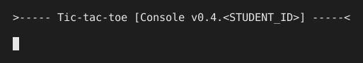 | 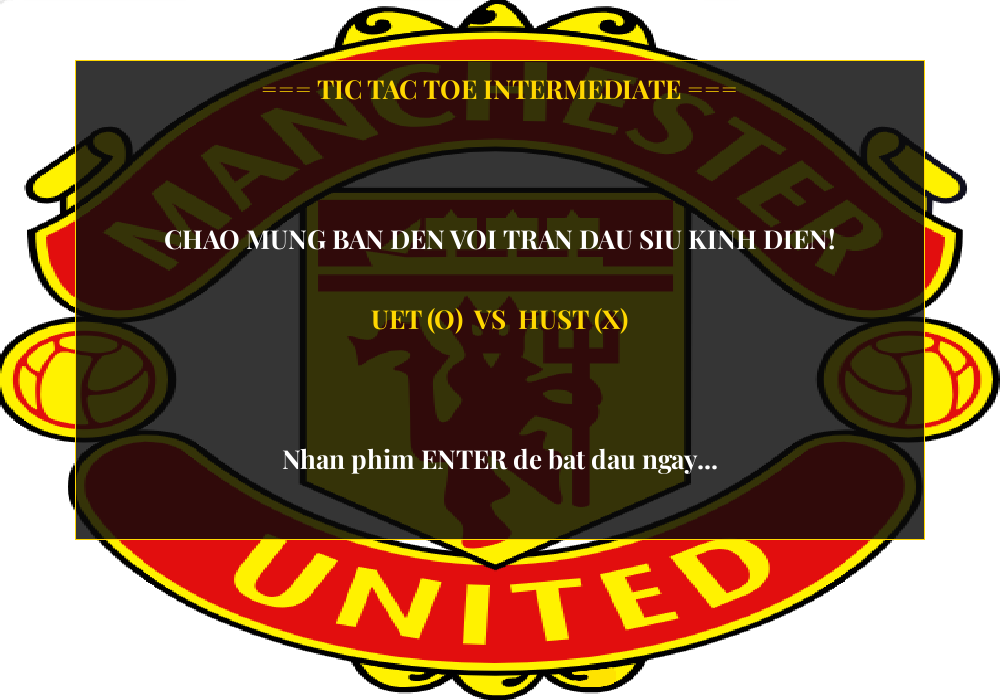 |
| **(b)** Chọn chế độ chơi | 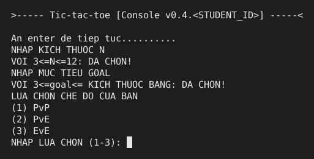 | 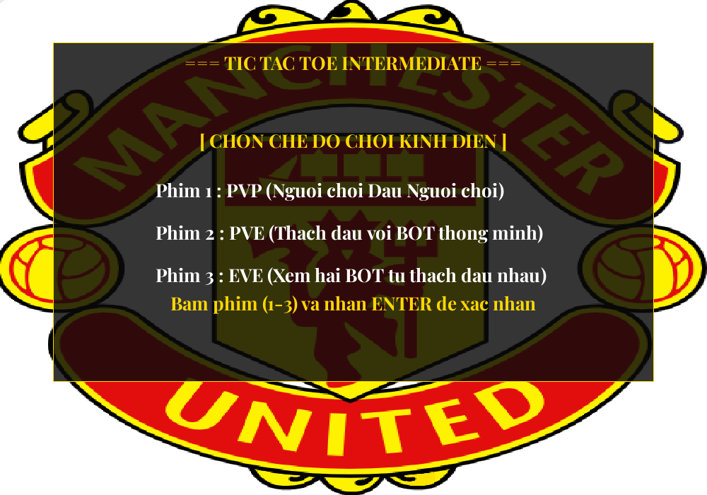 |
| **(c)** Chọn mức bot | 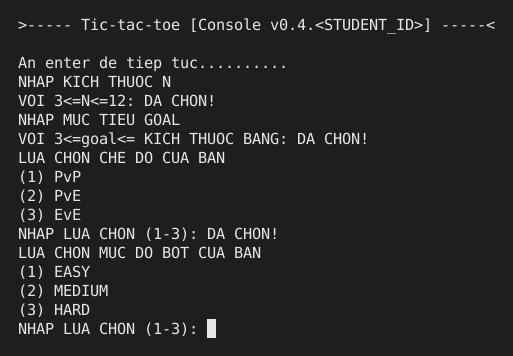 | 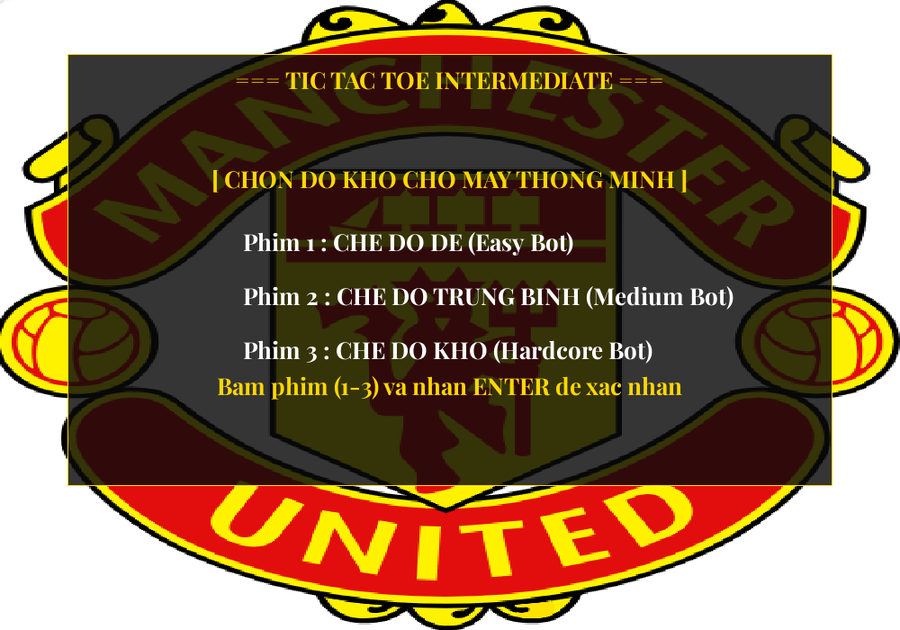 |
| **(d)** Người chơi đánh (3,3), bot HARD trả lời (2,2) — ô viền vàng phía SDL | 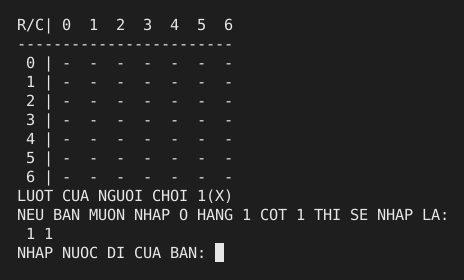 | 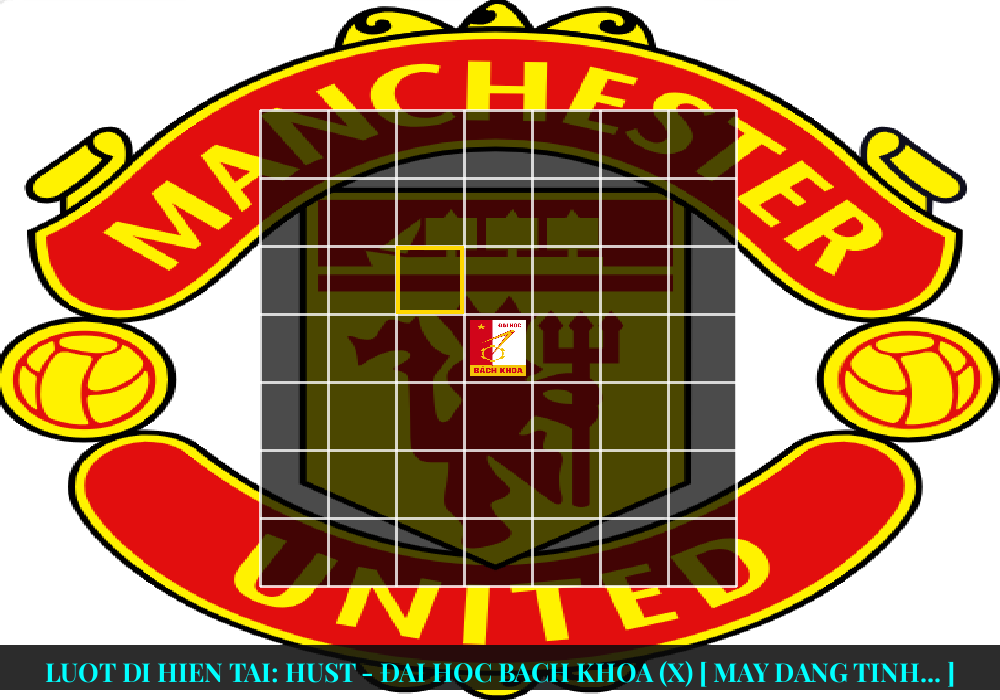 |
| **(e)** Đến lượt người chơi — Terminal: sau nước thứ nhất của bot (nhập toạ độ); SDL: sau nước thứ ba của bot (click chuột) | 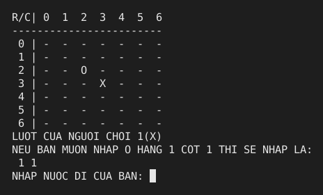 | 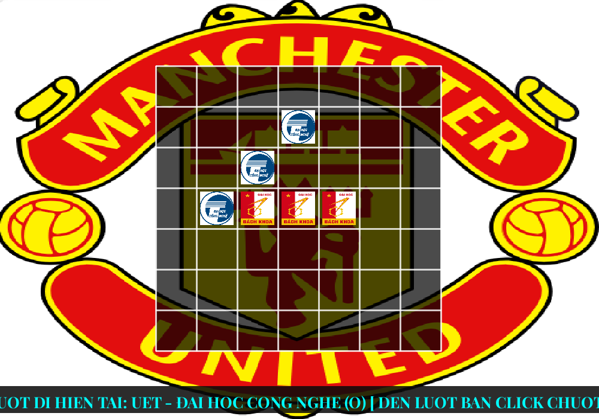 |
| **(f)** Kết quả: bot (O) thắng bằng đường chéo (0,4)–(3,1); SDL tô đường thắng màu đỏ | 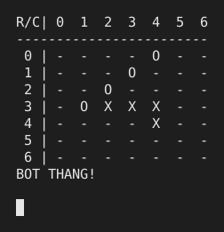 | 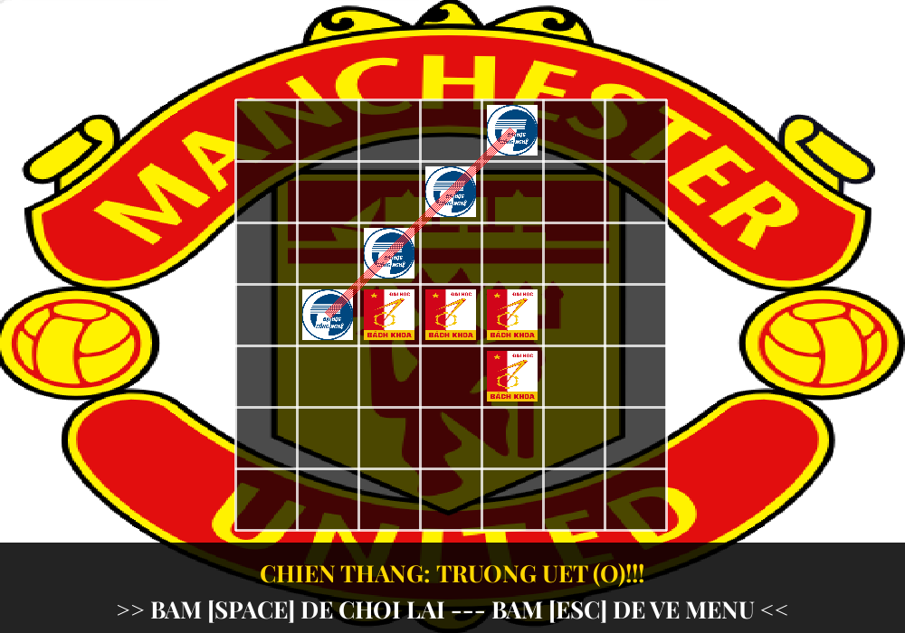 |

**Nhận xét.** Hai giao diện hiển thị cùng thông tin (menu, bàn cờ, lượt đi, kết quả) vì cùng được gọi qua `I_Renderer`. Terminal gọn, phù hợp kiểm thử và chấm tự động; SDL trực quan hơn: quân cờ là logo, nước vừa đi được highlight, đường thắng được tô, người chơi chỉ cần click thay vì gõ toạ độ. Ngược lại, SDL cần xử lý thêm nhiều chi tiết (căn chữ, toạ độ pixel, hàng đợi sự kiện).

### 3.2 Tài nguyên game (Assets)

| Tệp | Kích thước | Vai trò / cách dùng |
|---|---|---|
| `LOGO_MANUTD.png` | 547×556 | Ảnh nền, kéo giãn phủ toàn cửa sổ (`SDL_RenderCopy(..., NULL, NULL)`). |
| `LOGO_HUST.png` | 282×426 | Sprite quân X, co vào ô với lề 10%. |
| `LOGO_UET.png` | 242×245 | Sprite quân O. |
| `font.ttf` | — | Playfair Display, kiểu Bold, cỡ 26pt, dùng cho mọi chữ trên GUI. |

Ảnh được nạp bằng `IMG_LoadTexture()` thành `SDL_Texture` một lần trong `init()` và giải phóng trong `close()`; không dùng sprite sheet hay animation nên không cần cắt frame. Logo là hình ảnh sưu tầm từ Internet, chỉ dùng cho mục đích học tập; font Playfair Display là font mã nguồn mở (SIL Open Font License) của Google Fonts.

<p align="center">
  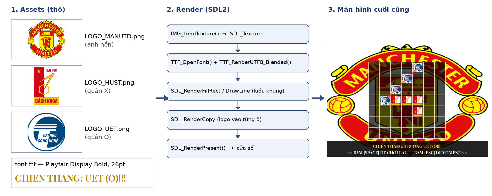<br>
  <sub><b>Hình 4.</b> Pipeline: Assets (ảnh/font) → Render (SDL2) → Màn hình cuối cùng.</sub>
</p>

### 3.3 Trích dẫn Log

**UI và Dev Tool là hai kênh khác nhau.** Trên màn hình người chơi chỉ thấy "`BOT(NGUOI CHOI 2) DANG SUY NGHI...`" và "`DA DANH VAO VI TRI (2, 2)`", còn file log (bật `-v`) ghi lại trạng thái nội bộ mà người chơi không cần biết: cấu hình, từng bước của Engine, độ sâu tìm kiếm, số nút đã duyệt, điểm heuristic và thời gian chạy của bot.

<details>
<summary><b>Luồng Engine và cấu hình</b> (GUI, <code>./game -g -v -l logs/log_graphic_flag.txt</code>)</summary>

```log
[INFO] - [2026-10-15 16:40:31] Game starting . . .
[DEBUG] - [2026-10-15 16:40:31] RunConfig {
  interactive:  true
  judge_mode:   false
  ...
  verbose_flag: true
  gui_flag:     true
}
[INFO] - [2026-10-15 16:40:31] Engine initializing . . .
[INFO] - [2026-10-15 16:40:31] Engine initialized!
[INFO] - [2026-10-15 16:40:31] [Engine] Starting game . . .
[DEBUG] - [2026-10-15 16:40:35] user input 'size' = 7
[DEBUG] - [2026-10-15 16:40:37] user input 'goal' = 4
[DEBUG] - [2026-10-15 16:40:39] user input 'game mode' = PVE
[DEBUG] - [2026-10-15 16:40:41] user input 'bot level' = HARD
[INFO] - [2026-10-15 16:40:41] Board initialized!
[INFO] - [2026-10-15 16:40:41] [Engine] Game started!
[INFO] - [2026-10-15 16:40:41] [Engine] Playing game . . .
```

</details>

<details>
<summary><b>Sự kiện tương tác và quyết định của bot</b></summary>

Nước đi của người (click chuột) và của bot được ghi cùng định dạng; dòng `[BotLv3]` cho thấy bot đã duyệt bao nhiêu trạng thái và điểm của nước được chọn. Ở lượt 7, bot nhận ra nước thắng ngay nên bỏ qua Minimax:

```log
[DEBUG] - [2026-10-15 16:40:42] player 1 make move to (3, 3)
[DEBUG] - [2026-10-15 16:40:42] [BotLv3] minimax depth=6 candidates=8 nodes=11406 -> move (2, 2) score=-1530
[DEBUG] - [2026-10-15 16:40:42] execution time of [bot#1->getMove()()] = 0.0304247s
[DEBUG] - [2026-10-15 16:40:42] player 2 make move to (2, 2)
...
[DEBUG] - [2026-10-15 16:40:49] player 1 make move to (4, 4)
[DEBUG] - [2026-10-15 16:40:49] [BotLv3] winning move at (0, 4)
[DEBUG] - [2026-10-15 16:40:49] execution time of [bot#1->getMove()()] = 3.0988e-05s
[DEBUG] - [2026-10-15 16:40:49] player 2 make move to (0, 4)
[INFO] - [2026-10-15 16:40:51] [Engine] Game done!
[INFO] - [2026-10-15 16:40:51] [Engine] Ending game . . .
[DEBUG] - [2026-10-15 16:40:51] [WinLine] cells: (0, 4) (1, 3) (2, 2) (3, 1)
```

Log GUI dừng ở `[WinLine]` vì chương trình đang chờ người chơi nhấn SPACE/ESC khi tiến trình được đóng.

</details>

<details>
<summary><b>Bot đánh hoàn hảo trên bàn 3×3</b> (judge mode, EvE HARD vs HARD)</summary>

Khi còn ≤ 9 ô trống, độ sâu bằng số ô trống (8, 7, …) và hai bot hoà sau 9 nước — đúng kết quả lý thuyết của Tic-tac-toe:

```log
[DEBUG] - [2026-10-15 16:42:55] player 1 make move to (1, 1)
[DEBUG] - [2026-10-15 16:42:55] [BotLv3] minimax depth=8 candidates=8 nodes=296 -> move (0, 0) score=0
[DEBUG] - [2026-10-15 16:42:55] [BotLv3] minimax depth=7 candidates=7 nodes=192 -> move (0, 2) score=0
[DEBUG] - [2026-10-15 16:42:55] [BotLv3] block opponent at (2, 0)
...
[DEBUG] - [2026-10-15 16:42:55] after 9 turns
[DEBUG] - [2026-10-15 16:42:55] game end with result: draw
```

</details>

### 3.4 Đánh giá bot HARD mới

**Thời gian suy nghĩ** (từ log judge mode, bàn 12×12, `goal` = 5, lệnh `./game -j -i <input> -v -l <log>`):

| Trận | Kết quả | TB/nước | Max/nước | Nút TB | Nút max |
|---|---|:---:|:---:|:---:|:---:|
| HARD vs MEDIUM | HARD thắng, 25 nước | 0.045 s | 0.160 s | 5 132 | 14 406 |
| HARD vs HARD | Hoà, 144 nước (đầy bàn) | 0.047 s | 0.179 s | 6 127 | 18 629 |

<sub><b>Bảng 3.</b> Thời gian chạy <code>BotLevel3::getMove()</code> đo bằng <code>measureExecutionTime</code>.</sub>

**Đối đầu với các bot khác.** Chương trình thử nghiệm riêng cho **bot HARD mới** đấu 40 ván với mỗi đối thủ ở mỗi cấu hình, đổi bên đi trước sau mỗi ván; 2 nước đầu tiên (mỗi bên 1 nước) được chọn ngẫu nhiên để các ván không trùng nhau. "HARD cũ" là phiên bản dò mẫu 995 dòng trước đây.

<table>
  <thead>
    <tr>
      <th rowspan="2">Bàn / goal</th>
      <th colspan="3">vs EASY</th>
      <th colspan="3">vs MEDIUM</th>
      <th colspan="3">vs HARD cũ</th>
      <th rowspan="2">Max<br>s/nước</th>
    </tr>
    <tr>
      <th>T</th><th>H</th><th>B</th>
      <th>T</th><th>H</th><th>B</th>
      <th>T</th><th>H</th><th>B</th>
    </tr>
  </thead>
  <tbody align="center">
    <tr><td>3×3 / 3</td><td>38</td><td>2</td><td>0</td><td>22</td><td>17</td><td>1</td><td>20</td><td>20</td><td>0</td><td>0.000</td></tr>
    <tr><td>4×4 / 3</td><td>40</td><td>0</td><td>0</td><td>36</td><td>3</td><td>1</td><td>36</td><td>1</td><td>3</td><td>0.006</td></tr>
    <tr><td>5×5 / 4</td><td>40</td><td>0</td><td>0</td><td>18</td><td>22</td><td>0</td><td>20</td><td>20</td><td>0</td><td>0.026</td></tr>
    <tr><td>7×7 / 4</td><td>40</td><td>0</td><td>0</td><td>39</td><td>1</td><td>0</td><td>37</td><td>2</td><td>1</td><td>0.027</td></tr>
    <tr><td>8×8 / 5</td><td>40</td><td>0</td><td>0</td><td>24</td><td>16</td><td>0</td><td>21</td><td>19</td><td>0</td><td>0.075</td></tr>
    <tr><td>10×10 / 5</td><td>40</td><td>0</td><td>0</td><td>31</td><td>9</td><td>0</td><td>29</td><td>11</td><td>0</td><td>0.118</td></tr>
    <tr><td>12×12 / 5</td><td>40</td><td>0</td><td>0</td><td>36</td><td>4</td><td>0</td><td>37</td><td>2</td><td>1</td><td>0.137</td></tr>
    <tr><td><b>Tổng (280 ván)</b></td><td><b>278</b></td><td><b>2</b></td><td><b>0</b></td><td><b>206</b></td><td><b>72</b></td><td><b>2</b></td><td><b>200</b></td><td><b>75</b></td><td><b>5</b></td><td></td></tr>
  </tbody>
</table>

<sub><b>Bảng 4.</b> Kết quả của bot HARD mới (T = thắng, H = hoà, B = thua).</sub>

**Nhận xét.**

- Bot HARD mới thua 7/840 ván ở Bảng 4; một phần do nước đầu của chính nó bị chọn ngẫu nhiên nên có ván bắt đầu từ thế bất lợi (trên bàn 3×3, bot tìm hết cây nên mọi ván thua đều xuất phát từ thế đã thua sẵn). Chạy lại 840 ván *không* có nước ngẫu nhiên đầu ván: 709 thắng – 129 hoà – **2 thua** (1 trước MEDIUM ở 7×7, 1 trước HARD cũ ở 12×12). Như vậy trên bàn lớn bot chưa phải bất bại — đây là giới hạn của tìm kiếm độ sâu cố định với heuristic đơn giản.
- Kiểm thử vét cạn trên bàn 3×3 từ bàn trống — cho đối thủ thử *mọi* chuỗi nước đi có thể, bot lần lượt cầm X và O — cho **533 ván, 0 ván thua**: bot đánh hoàn hảo ở Tic-tac-toe cổ điển.
- So với bot HARD cũ: 200 thắng – 75 hoà – 5 thua, trong khi mã nguồn ngắn hơn (414 dòng có chú thích so với 995 dòng) và dễ đọc hơn.
- Thời gian tối đa mỗi nước khoảng 0.2 s ở mọi cấu hình nhờ cắt tỉa Alpha-Beta, giới hạn 10 nước/tầng và cập nhật điểm tăng dần.
- Hạn chế: heuristic chưa phân biệt chuỗi "mở hai đầu" với chuỗi "bị chặn một đầu" (quan trọng với luật OPEN_TWO), và độ sâu cố định 6. Hướng cải tiến: thêm trọng số cho đầu mở, *iterative deepening* có giới hạn thời gian, bảng chuyển vị (*transposition table*).

---

## 4. Nhận xét và tổng kết bài làm

**Về phong cách lập trình.** OOP giúp chia trò chơi thành các khối có trách nhiệm rõ ràng và cho phép thay thế từng khối: việc viết lại bot HARD lần này chỉ đụng tới đúng hai tệp `bot_lv3.*`, Engine và giao diện không phải sửa một dòng nào. Điểm yếu là phải viết nhiều mã "khung" (interface, constructor, destructor ảo, factory) và luồng chạy bị phân tán qua nhiều lớp nên khó lần theo hơn khi mới đọc. Với dự án lớn và thay đổi thường xuyên như một trò chơi, OOP dễ bảo trì hơn hẳn; nhưng không phải dự án nào cũng cần — một script xử lý dữ liệu ngắn hay một thuật toán đơn lẻ viết theo kiểu thủ tục lại gọn và rõ hơn.

**Về giao diện người dùng.** Phần thú vị nhất là thấy bàn cờ, logo và đường thắng hiện ra thật sự trên cửa sổ, và tự tay xử lý chuột/bàn phím. Khó khăn lớn là tư duy hướng sự kiện của SDL: sự kiện còn sót trong hàng đợi, toạ độ pixel, căn chữ. Em thích giao diện đồ hoạ hơn vì trải nghiệm chơi tốt hơn nhiều, nhưng Terminal vẫn rất cần thiết để kiểm thử nhanh và chạy chế độ chấm điểm.

**Về tổ chức mã nguồn.** Tách nhiều tệp kèm docstring giúp mỗi tệp ngắn, tìm đúng chỗ cần sửa nhanh, biên dịch lại từng phần và làm việc nhóm ít xung đột hơn; đổi lại phải quản lý `#include`, CMake và nhảy giữa nhiều tệp. Gom vào một tệp chỉ hợp với chương trình nhỏ, viết một lần (bài Level 1, bài thi lập trình). Khi chương trình có nhiều mô-đun, nhiều giao diện hoặc sẽ còn mở rộng thì nên tách tệp như bài này.

**Về thiết kế chương trình.** Các công cụ AI viết mã rất nhanh, nhưng chất lượng kết quả phụ thuộc vào việc con người *mô tả đúng bài toán và thiết kế*: chọn thuật toán nào, luật thắng chính xác là gì, ràng buộc thời gian ra sao, các lớp giao tiếp với nhau thế nào. Con người vẫn giữ vai trò quyết định thiết kế, kiểm chứng và chịu trách nhiệm cho sản phẩm; AI là công cụ tăng tốc. Vấn đề của AI hiện tại là có thể sinh mã "trông đúng" nhưng sai với ngữ cảnh — ví dụ dùng luật thắng khác với `Logic::checkWin` — nên luôn cần kiểm thử độc lập (như phép so sánh 168 060 thế cờ ở mục [2.2](#kiểm-tra-thắng-khớp-với-luật-của-game)).

**Bài học rút ra.** Khó khăn lớn nhất là *vấn đề thiết kế*: làm sao để một luồng tuần tự phục vụ được cả Terminal lẫn SDL vốn hướng sự kiện. Với bot, bài học là nên bắt đầu từ một thuật toán có nền tảng (Minimax/Alpha-Beta) với hàm đánh giá đơn giản, đo đạc bằng log và kiểm thử tự động, thay vì liệt kê thủ công các trường hợp.

---

## 5. Ghi chú sử dụng AI (AI Disclosure)

| Mục | Nội dung |
|---|---|
| **Công cụ** | Claude (Anthropic) |
| **Mục đích** | (1) Viết lại `BotLevel3` theo thuật toán Minimax + Alpha-Beta + heuristic cửa sổ do sinh viên định hướng, tối ưu cho dễ đọc (chú thích tiếng Việt, mỗi hàm một nhiệm vụ); (2) viết chương trình kiểm thử so sánh `isWinningMove` với `Logic::checkWin` và cho các bot đấu với nhau; (3) hỗ trợ soạn thảo và trình bày báo cáo LaTeX, vẽ sơ đồ. |
| **Mức độ** | Tệp `bot_lv3.h/.cpp`: phần lớn do AI sinh, sinh viên đọc hiểu, chạy thử và kiểm chứng. Báo cáo: AI soạn bản nháp, sinh viên chỉnh sửa. Các mô-đun còn lại (Engine, Logic, Terminal, SDL, BotLevel1/2, Factory): sinh viên tự cài đặt. |

---

## 6. Nguồn tham khảo (References)

1. Viện Trí tuệ nhân tạo – ĐH Công nghệ, *Bài tập lớn Level 2 – Lập trình hướng đối tượng*, tài liệu học phần 2526II.UET.AI2013, 2026.
2. S. Russell, P. Norvig, *Artificial Intelligence: A Modern Approach*, 4th ed., Pearson, 2020 — Chương 5: Adversarial Search (Minimax, Alpha-Beta pruning, evaluation functions).
3. D. E. Knuth, R. W. Moore, "An analysis of alpha-beta pruning", *Artificial Intelligence*, 6(4):293–326, 1975.
4. Lazy Foo' Productions, *Beginning Game Programming v2.0 (SDL2 tutorials)*, <https://lazyfoo.net/tutorials/SDL/>.
5. SDL Wiki – SDL2 API, SDL_ttf, SDL_image, <https://wiki.libsdl.org/>.
6. cppreference.com – C++20 standard library (`std::format`, `std::unique_ptr`, `std::stable_sort`), <https://en.cppreference.com/>.
7. E. Gamma, R. Helm, R. Johnson, J. Vlissides, *Design Patterns: Elements of Reusable Object-Oriented Software*, Addison-Wesley, 1994 (Factory, Strategy).

<p align="center"><a href="#báo-cáo-bài-tập-lớn--level-2-tic-tac-toe">↑ Lên đầu trang</a> · <a href="../README.md">← Về trang chính</a></p>
